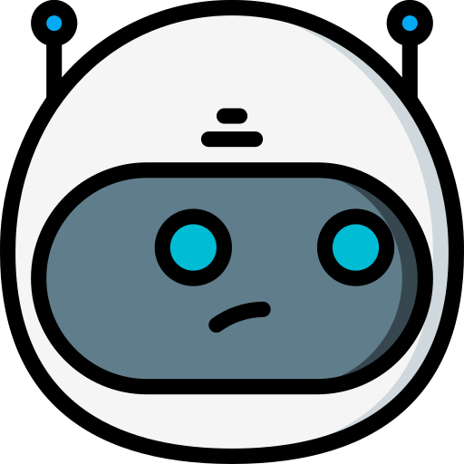

#  AI Chess Coach

**AI Chess Coach** is an interactive chess game analysis web application that combines the tactical precision of **Stockfish** with the pedagogical explanations of a **locally hosted Large Language Model (Gemma 4 via Ollama)**.

Instead of relying on cloud APIs or letting a language model guess chess moves (which typically leads to severe hallucinations), this project uses an **agentic tool-calling architecture** that grounds every explanation in real-time board states and Stockfish evaluations.

---

## ✨ Key Features

- **PGN Game Import & Replay**: Paste any PGN game to step through moves using on-screen controls or keyboard arrow keys (`←`, `→`, `↑`, `↓`), with automatic move-list scrolling and board orientation flipping.
- **Real-Time Stockfish Streaming (SSE)**: Streams engine evaluations and best-move arrows across increasing search depths (`depth 12` to `26`) using Server-Sent Events, paired with a dynamic Lichess/Chess.com-style **Evaluation Bar**.
- **100% Local AI Chess Coach**: Ask natural-language questions about any position or blunder (e.g., *"Why is c3b5 a blunder and how can Black punish it?"*) and get concise, human-friendly chess explanations powered locally by **Gemma 4 (`gemma4:e4b`)**.

---

## 🧠 How We Prevent LLM Hallucinations (Local LLM + Tool Calling)

Standard LLMs struggle with chess: they lose track of piece placements in FEN strings, invent illegal moves, or use vague literary filler to hide calculation errors.

To solve this while running a lightweight local model (**`gemma4:e4b`** via **Ollama** with reasoning/thinking enabled), the backend (`backend-coach/llm.py` & `backend-coach/llm_tools.py`) enforces a strict **Tool-Calling Loop**:

1. **Blind-First Architecture**:
   The raw FEN is **never** given directly to the LLM in the user prompt. To know what is on the board, the model is forced to call tools first.
2. **Dedicated Grounding Tools (`llm_tools.py`)**:
   - **`get_board_representation()`**: Parses the current FEN into an explicit dictionary of squares and piece names (`white_pawns`, `black_pawns`, `other_white_pieces`, `other_black_pieces`, and `side_to_move`) so the LLM never misreads a FEN string.
   - **`get_stockfish_best_move()`**: Queries the Stockfish engine for the best move in coordinate notation and its objective evaluation.
   - **`play_move(move)`**: Plays a move on the analysis board to explore multi-move tactical continuations (2–3+ plies). To prevent small-model formatting errors (like passing `"Nd4b5"` instead of `"d4b5"`), inputs are automatically sanitized (`clean_uci_move`). It also explicitly computes and returns:
     - `moving_piece` & `captured_piece` (including *en passant*), so the LLM doesn't have to mentally diff two 32-piece JSON arrays to know what was captured.
     - `evaluation_before` & `evaluation_after`.
     - `opponent_best_reply` from Stockfish, allowing the agent to immediately follow the opponent's refutation.
   - **`try_move(move_try)`**: Simulates a single candidate move and returns the evaluation delta and capture info while automatically resetting the board back to the original position.
3. **Pedagogical Translation Prompt (`CHESS_PROMPT`)**:
   The system prompt forbids raw engine jargon (`centipawns`, numeric scores like `+1.5`) and vague literary filler, requiring the model to translate Stockfish's findings into concrete moves, squares, captured pieces, and tactical motifs (*fork, pin, skewer, hanging piece, loss of tempo, center control*).

---

## 🛠️ Tech Stack & Architecture

```
AI-ChessCoach/
├── src/                        # React 19 + TypeScript + Vite Frontend
│   ├── Home.tsx                # PGN import page
│   ├── ChessPage.tsx           # Interactive board, eval bar, move history & coach chat
│   └── App.css                 # Responsive styling & evaluation bar animations
└── backend-coach/              # Python FastAPI Backend
    ├── main.py                 # Port 8000: Stockfish SSE evaluation stream (/analyze-stream)
    ├── llm_server.py           # Port 8001: Coach Q&A endpoint (/LLM-answer)
    ├── llm.py                  # Ollama agent loop & CHESS_PROMPT
    ├── llm_tools.py            # Stockfish & board inspection tools for the LLM
    └── utils.py                # FEN piece mapping utilities
```

---

## 🚀 Getting Started

### Prerequisites
1. **Node.js** (v18+)
2. **Python** (3.10+)
3. **Stockfish binary**: Place the Stockfish executable in `./stockfish/` (configured in `backend-coach/main.py` and `backend-coach/llm_server.py`).
4. **Ollama**: Install [Ollama](https://ollama.com/) and pull the local model:
   ```bash
   ollama pull gemma4:e4b
   ```

### 1. Start the Python Backends
Install the required Python packages (`fastapi`, `uvicorn`, `stockfish`, `ollama`) and run both servers from the `backend-coach` directory:

```bash
cd backend-coach
# Terminal 1: Real-time Stockfish evaluation server (port 8000)
python main.py

# Terminal 2: Local LLM Coach server (port 8001)
python llm_server.py
```

### 2. Start the Frontend
From the project root:

```bash
npm install
npm run dev
```
Open `http://localhost:5173` in your browser.

---

## 📜 Credits, Third-Party Libraries & Licenses

This project builds upon the following open-source libraries, engines, and models:

| Resource | Role in Project | License |
| :--- | :--- | :--- |
| **[Stockfish](https://github.com/official-stockfish/Stockfish)** | Chess engine used for position evaluation, best-move calculation, and LLM tool grounding | [GPL-3.0](https://github.com/official-stockfish/Stockfish/blob/master/Copying.txt) |
| **[py-stockfish (`stockfish`)](https://github.com/py-stockfish/stockfish)** | Python wrapper used to interface with the Stockfish engine via UCI | [MIT License](https://github.com/py-stockfish/stockfish/blob/master/LICENSE) |
| **[chess.js](https://github.com/jhlywa/chess.js)** | Move validation, PGN parsing, FEN generation, and game history management | [BSD-2-Clause License](https://github.com/jhlywa/chess.js/blob/master/LICENSE) |
| **[react-chessboard](https://github.com/Clariity/react-chessboard)** | Interactive React chessboard component, square highlighting, and best-move arrows | [MIT License](https://github.com/Clariity/react-chessboard/blob/main/LICENSE) |
| **[Ollama](https://github.com/ollama/ollama)** & **[ollama-python](https://github.com/ollama/ollama-python)** | Local LLM runtime and Python SDK for tool calling and thinking mode | [MIT License](https://github.com/ollama/ollama/blob/main/LICENSE) |
| **[Gemma 4](https://deepmind.google/models/gemma/)** | Local language model (`gemma4:e4b`) powering the chess coach | [Gemma Terms of Use / Apache-2.0](https://ai.google.dev/gemma/terms) |
| **[FastAPI](https://github.com/fastapi/fastapi)** & **[Uvicorn](https://github.com/encode/uvicorn)** | Python web framework and ASGI server for REST & Server-Sent Events (SSE) | MIT / BSD-3-Clause |
| **[React](https://react.dev/)**, **[Vite](https://vite.dev/)** & **[Lucide Icons (`lucide-react`)](https://lucide.dev/)** | Frontend UI framework, build tooling, and interface icons | MIT / ISC |

> **Note on Stockfish License (GPLv3):** Stockfish is free software distributed under the **GNU General Public License v3.0 (GPLv3)**. In accordance with the GPLv3, the full source code and license notices for Stockfish are available in the official [Stockfish repository](https://github.com/official-stockfish/Stockfish).
